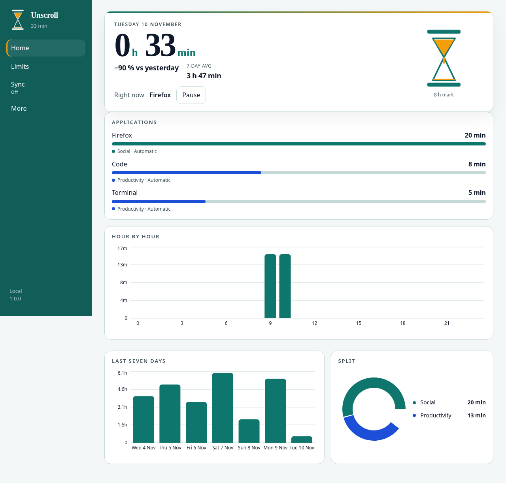
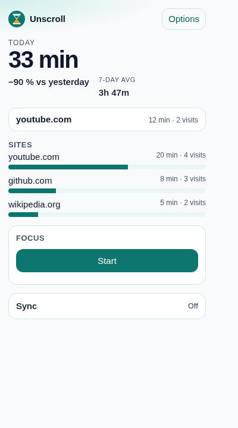

# Unscroll

**Unscroll** is a free, open-source screen time tracker for Android, desktop (Windows, macOS, Linux), and your browser (Chrome, Edge, Firefox). It shows where your time goes, lets you set limits and focus sessions, and keeps your data on your own devices.

No account, no ads, no trackers. Sync between devices is optional and end-to-end encrypted.

<p align="center">
  
  
</p>

## Features

- **Screen time per app or site**: today, hour by hour, last 7 days, history, categories.
- **Limits**: daily limits per app, category, or site, with an optional "a few more minutes" allowance and a strict mode.
- **Focus sessions and schedules**: block distractions for 25 minutes, 50 minutes, or a custom length, or on set days and hours.
- **Reminders and summaries**: break reminders and a daily summary notification.
- **Android extras**: home-screen widget, unlock counts, badges and streaks, permissions asked only when a feature needs them.
- **Export and import**: CSV and JSON. Exports never contain sync tokens or keys.
- **Languages**: English (default), French, Spanish, German, Portuguese.
- **Optional sync**: one encrypted vault shared by your phone, computer, and browser, paired with a QR code.

## Privacy

- **Local-first.** Usage data stays on the device. Nothing leaves it unless you turn sync on.
- **No trackers.** No analytics, telemetry, ads, remote crash reporting, or third-party SDKs. No fonts or scripts from a CDN.
- **End-to-end encrypted sync.** Each device encrypts with AES-256-GCM using a 32-byte key that never leaves your devices. The server stores opaque ciphertext and never sees the key or your data.
- **Anonymous accounts.** Turning sync on creates an anonymous account. No email, no password. The server keeps only a SHA-256 hash of the access token.

The pairing QR code and `unscroll://pair` link contain the server URL, the token, and the key. Treat them like a password.

## Platforms

| Folder | Platform | Stack |
| --- | --- | --- |
| [`android/`](android/) | Android 8.0+ (API 26) | Kotlin, Jetpack Compose, Room, WorkManager |
| [`desktop/`](desktop/) | Windows, macOS, Linux | Electron, React, SQLite |
| [`extension/`](extension/) | Chrome, Edge, Firefox 142+ (Manifest V3) | TypeScript, Vite |
| [`server/`](server/) | Self-hosted sync server | Go, SQLite |

## Build

Each folder builds on its own. See its README for details.

### Android

Requires JDK 17 and the Android SDK (compileSdk 36).

```bash
cd android
./gradlew :app:assembleDebug :app:testDebugUnitTest
# APK: app/build/outputs/apk/debug/app-debug.apk
```

### Desktop

Requires Node.js 22+, plus `python3`, `make`, and `g++` to build `better-sqlite3`.

```bash
cd desktop
npm install
npm test
npm run dist:linux   # or dist:win, dist:mac; output in release/
```

### Browser extension

Requires Node.js 22+.

```bash
cd extension
npm install
npm test
npm run build        # load dist/ as an unpacked extension
npm run zip          # unscroll-extension.zip
```

### Sync server

Requires Go 1.22+.

```bash
cd server
go build ./... && go test ./...
go build -o bin/unscroll-sync-server ./cmd/unscroll-sync-server
```

## Self-hosting the sync server

Self-hosting is free and fully supported. In each app, open **Sync** and replace the default server URL with your own `https://` address.

**Docker**

```bash
cd server
docker build -t unscroll-sync-server .
docker run -d --name unscroll-sync -p 127.0.0.1:8781:8781 \
  -v unscroll-sync:/data unscroll-sync-server
```

**Binary**

```bash
export DATA=/var/lib/unscroll-sync   # directory for sync.db (required)
export ADDR=127.0.0.1:8781           # listen address
./bin/unscroll-sync-server
```

| Variable | Purpose |
| --- | --- |
| `DATA` | Directory for the SQLite database. Required. |
| `ADDR` | Listen address. Default `127.0.0.1:8781`. |
| `UNSCROLL_SYNC_TOKEN_SHA256` | Optional. Only to migrate a legacy single-vault database. |
| `UNSCROLL_SYNC_TOKENS_FILE` | Optional. Extra token hashes for the legacy vault. |

Keep the server on localhost and put a TLS reverse proxy (for example Caddy) in front. Never commit tokens, token hashes, or env files. Full details: [`server/README.md`](server/README.md), protocol: [`docs/sync-protocol.md`](docs/sync-protocol.md), pairing: [`docs/pairing.md`](docs/pairing.md).

## Hosted sync (coming soon)

If you would rather not run a server, an optional hosted sync service is planned: **€2.99/month or €24/year, with a 14-day free trial**. It is the only paid part of Unscroll and it only pays for hosting. The apps stay free and complete, and self-hosting stays free. Billing is not available yet.

## License

Unscroll is licensed under the [GNU Affero General Public License v3.0](LICENSE) (AGPL-3.0-only).

## Contributing

Issues and pull requests are welcome.

- Keep changes focused, and run the build and tests of the folder you touched before opening a pull request.
- New UI text goes through the translation files. English is the source language. Add the other languages if you can, or leave them in English and say so in the pull request.
- Privacy is a feature: no analytics, trackers, or remote assets.
- Never commit secrets (`.env`, keystores, tokens).
- Contributions must be your own work. Do not copy code, text, or assets from other screen time apps.
